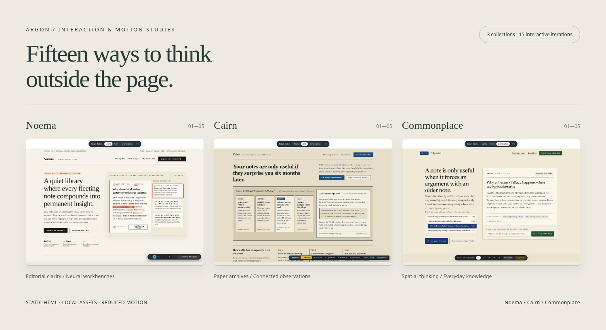

<p align="center">
  
</p>

# Argon · Second-brain design studies

**Three collections. Fifteen interactive iterations.** An exploration of personal knowledge tools through editorial layouts, slip boxes, spatial canvases, and field ledgers, built with static HTML, CSS, and JavaScript.

[](https://github.com/falconrapid19925/argon4test/actions/workflows/ci.yml)
[](https://github.com/falconrapid19925/argon4test/actions/workflows/codeql.yml)
[](https://github.com/falconrapid19925/argon4test/releases)
[](LICENSE)

[**Explore the live showcase ↗**](https://falconrapid19925.github.io/argon4test/) · [Latest release](https://github.com/falconrapid19925/argon4test/releases/latest) · [Testing guide](tests/README.md) · [Contributing](CONTRIBUTING.md)

## The collections

| Collection      | Character                                                                                          | Open directly                                                                                                         |
| --------------- | -------------------------------------------------------------------------------------------------- | --------------------------------------------------------------------------------------------------------------------- |
| **Noema**       | Editorial monographs, neural constellations, Swiss grids, spatial desks, ambient synthesis         | [Five studies](https://falconrapid19925.github.io/argon4test/second_brain_landing_pages.html#/pages/1)                |
| **Cairn**       | Archival slips, scholarly margins, darkroom light tables, botanical ledgers, chronological streams | [Five studies](https://falconrapid19925.github.io/argon4test/cairn_second_brain_iterations.html#/pages/1)             |
| **Commonplace** | Folgezettel, cartography, daybooks, specimen presses, keyboard utilities                           | [Five studies](https://falconrapid19925.github.io/argon4test/second_brain_five_landing_page_iterations.html#/pages/1) |

Each iteration includes entrance motion and working interactions. Collection links remember the last iteration in your session. Hash routes survive reloads on an ordinary static server; the root showcase also offers an iframe viewer.

Use **1–5** to select an iteration, **[** / **]** to wrap between iterations, and **Escape** to close drawers or dialogs. Shortcuts leave editable fields alone. Inactive pages stay outside keyboard focus, animated labels expose one accessible text equivalent, and motion respects your system's reduced-motion preference.

These are interaction prototypes with sample data. Notes and inputs are demonstrations, with no backend or account system.

## Run locally

Browsing needs no dependency installation or build. All runtime assets, including fonts, text animation modules, and compiled utility styles, are local.

```sh
python3 -m http.server 8000 --bind 127.0.0.1
# Open http://127.0.0.1:8000
```

For development and tests, use **Node.js 24 LTS**:

```sh
npm ci
npx playwright install --with-deps chromium firefox webkit
npm start
```

The development server serves only site documents and assets. To rebuild Commonplace's utility stylesheet after changing classes, run `npm run build:styles`. Tailwind 4 generates utilities while a small compatibility reset preserves the original design defaults.

## Quality checks

```sh
npm run check             # ESLint, formatting, CSS reproducibility, server tests
npm run check:workflows   # Checksummed actionlint (Linux x64)
npm run test:dry-run      # List browser cases and deployment inputs; no browser or publish
npm run test:e2e          # Chromium, Firefox, and WebKit
npm run test:coverage     # Chromium tests plus measured runtime coverage and thresholds
npm audit --audit-level=high
npm run build            # Clean, deployable static site in dist/
```

The browser suite checks all 15 routes and primary interactions, reload/history, keyboard and rapid navigation, mobile layout, collection memory, iframe controls, reduced motion, and routing/storage fallbacks. Browser exceptions, console errors, failed required assets, and HTTP errors fail tests. Reports retain failure screenshots, traces, videos, and JUnit results.

Coverage measures **`assets/motion/motion.js`** using Chromium's V8 engine. Minimums: **90% lines/statements, 85% functions, 80% branches**. It excludes vendored libraries and inline demo scripts; the latter have route/interaction checks and ESLint validation. Details and report locations are in [tests/README.md](tests/README.md).

## Automation and releases

Pull requests run the same quality checks and three-browser matrix as `main`. With the Pages build source set to **GitHub Actions**, only a passing `main` build deploys to GitHub Pages. The deployment job checks this one-time repository setting. Every release reruns verification and publishes a static archive plus SHA-256 checksum. Manual release runs default to **dry run** and retain an archive without publishing.

GitHub Actions are pinned to immutable commit hashes, annotated with verified stable versions. Dependabot checks npm and Actions weekly; CodeQL runs on pull requests, `main`, and a weekly schedule. See [the maintenance guide](docs/MAINTAINING.md) for versions, Pages setup, release commands, and branch rules.

## Repository map

```text
├── index.html                        # Existing iframe showcase
├── *_iterations.html / *_pages.html  # Three collections, five iterations each
├── assets/
│   ├── motion/                       # Shared motion and navigation runtime
│   └── vendor/                       # Local libraries, fonts, styles, licenses
├── docs/                             # Preview and maintainer documentation
├── tests/                            # Playwright scenarios and server tests
├── tools/                            # Development server, build, coverage, preview
└── .github/                          # CI/CD, CodeQL, Dependabot, issue/PR templates
```

The three `page*.html` files are legacy standalone placeholders retained from the original Pages setup; they are not part of the release bundle. [ANIMATION_PLAN.md](ANIMATION_PLAN.md) records the original motion implementation plan.

## Contribute and credits

Read [CONTRIBUTING.md](CONTRIBUTING.md), the [code of conduct](CODE_OF_CONDUCT.md), and the [security policy](SECURITY.md). Bug reports should identify the collection, iteration, browser, and steps to reproduce.

Shared motion incorporates the **texts reveal** and **sliding tabs** recipes from [Transitions.dev](https://transitions.dev/) and the vanilla [slot-text](https://textmotion.dev/) API pinned to **0.3.4**. Short labels animate; long headings and paragraphs retain normal wrapping. Font sources and upstream license files live alongside the vendored assets.

Original project code is [MIT licensed](LICENSE). Third-party assets retain their own [licenses and attribution](docs/THIRD_PARTY.md).
